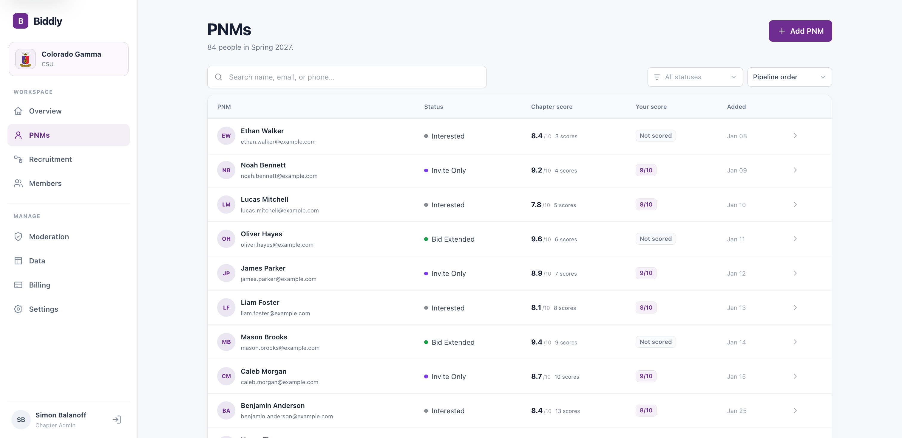
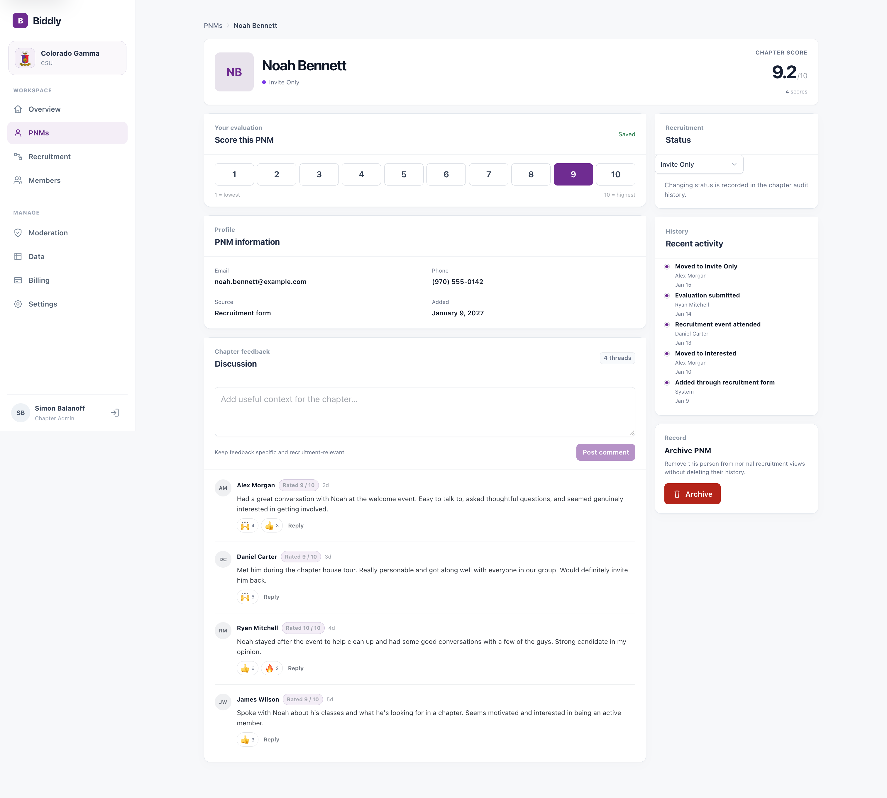
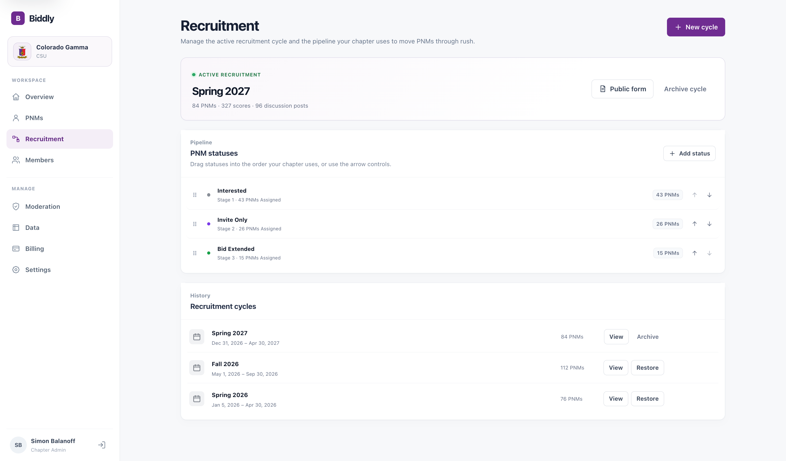

# Biddly

### Recruitment, without the chaos.

A platform built to help student organizations manage recruitment, evaluate prospective members, and keep their chapters on the same page.

**Independently built · Commercial SaaS · Private source code**

 

  

Recruitment dashboard · Demo data

## Why I built it

Recruitment involves a lot of people, conversations, events, and decisions. I originally built Biddly for my own fraternity chapter at Colorado State University to bring that work into one place.

What began as a chapter tool has grown into a commercial, multi-organization platform that I continue to develop and maintain.

<table>
  <tr>
    <td align="center" width="50%"><h3>340+</h3>People who have used the platform</td>
    <td align="center" width="50%"><h3>52</h3>New members recruited by my chapter in Fall 2026</td>
  </tr>
</table>

## Inside Biddly

### Everything in one place

Keep track of prospective new members (PNMs), their status in the recruitment process, chapter-wide ratings, and your own evaluations. Search and filter candidates without losing track of where anyone stands.

  

PNM management · Demo data

### Better decisions, together

Each PNM has a dedicated profile for evaluations, member discussion, and recruitment history. Feedback stays connected to the person and visible to the people who need it.

  

Candidate profile and chapter discussion · Demo data

### A workflow that fits the chapter

Configure recruitment stages, manage active cycles, and keep records from previous recruitment periods. Biddly also supports member permissions, recruitment forms, attendance tracking, and data exports.

  

Recruitment configuration and cycle history · Demo data

## Technology

Biddly is built as a TypeScript-first full-stack monorepo, with a Next.js and React frontend, a Fastify API, and a PostgreSQL database. It also uses Prisma, Docker, and Stripe.

**Next.js** · **React** · **TypeScript** · **Fastify** · **PostgreSQL** · **Prisma** · **Docker** · **Stripe**

Language distribution from the private application repository

  

## About this repository

This repository is a public showcase for Biddly, a commercial software product that I designed, built, and maintain. The application source code lives in a separate private repository.

All names, evaluations, discussion posts, and recruitment counts shown in the screenshots are **fictional demonstration data**. The usage figures in the *Why I built it* section describe real-world results.

---

Designed and developed by Simon Balanoff.

