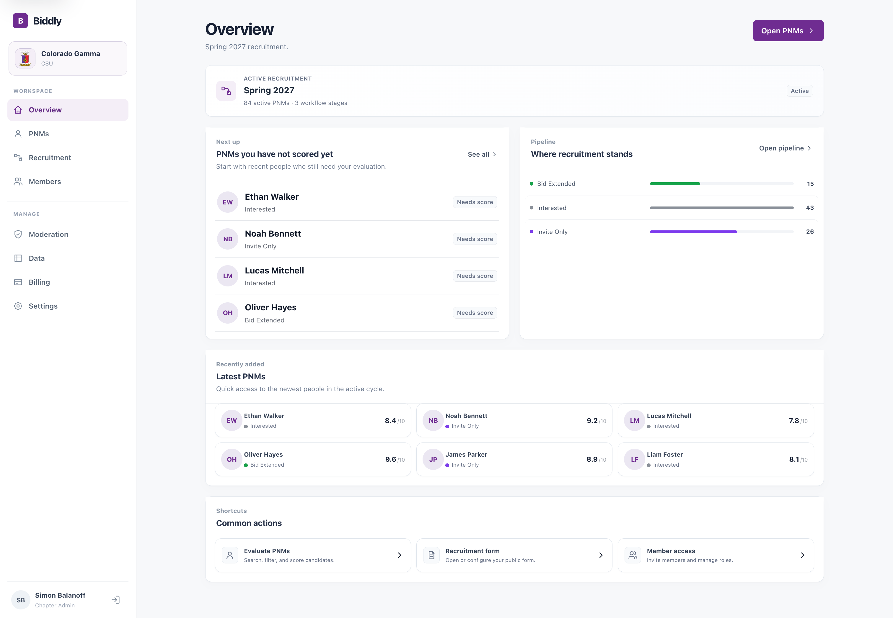

# Biddly

### Recruitment, without the chaos.

A modern platform for student organizations to manage recruitment, evaluate prospective members, and keep everyone on the same page.

**Commercial SaaS · Independently built · Closed source**

---

  

Product preview — replace with a screenshot using demonstration data.

## Built for real recruitment

Biddly started as a tool I built for my own fraternity chapter at Colorado State University. It has since grown into a multi-organization platform designed to make recruitment more organized, collaborative, and manageable.

<table>
  <tr>
    <td align="center" width="50%"><strong>340+</strong> Platform users</td>
    <td align="center" width="50%"><strong>52</strong> New members recruited in one chapter's Fall 2026 cycle</td>
  </tr>
</table>

## What it does

| | |
|---|---|
| **Prospect management** | Keep profiles, evaluations, and recruitment progress in one place. |
| **Member feedback** | Collect ratings and comments to support collaborative decisions. |
| **Events & attendance** | Manage events and track interactions with prospective members. |
| **Roles & permissions** | Give chapter administrators and members appropriate access. |
| **Multiple organizations** | Support independent workspaces, settings, and branding. |
| **Reporting** | Export recruitment data and review progress. |

## Inside Biddly

<table>
  <tr>
    <td width="50%"></td>
    <td width="50%"></td>
  </tr>
  <tr>
    <td align="center">Prospective member management</td>
    <td align="center">Events and attendance</td>
  </tr>
</table>

## Under the hood

Built as a TypeScript-first full-stack monorepo, with a Next.js frontend, Fastify API, and PostgreSQL database.

  
  
  
  
  
  
  
  

**Language distribution** · measured from the private application repository

## About this repository

This is a public showcase of **Biddly**, an independently developed commercial product. I designed, built, and maintain the application. Its source code and development history are kept in a separate private repository.

---

  Designed and developed by <strong>Simon Balanoff</strong>.

